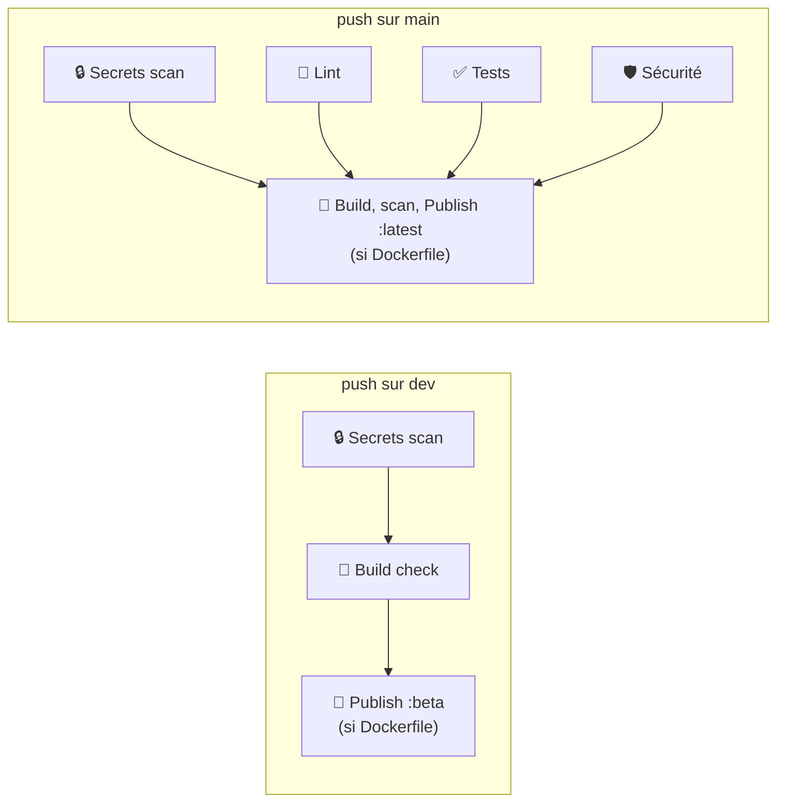

# Workflows GitHub Actions

## Deux niveaux de CI, un par branche

Voir la stratégie de branches de l'agent [5-cloture-archivage.md](../agents/5-cloture-archivage.md) : `dev` est la branche de travail, `main` ne reçoit que du code déjà validé. La CI reflète cette asymétrie plutôt que de rejouer la même chose deux fois.

### ci-dev.yml — rapide, juste de quoi avoir un `dev` fonctionnel

Déclenché sur `push` vers `dev`. Scan de secrets (rapide, quasi gratuit) + vérification que le projet compile/démarre, **sans lint ni suite de tests complète** — l'objectif est un retour en quelques minutes, pas un audit qualité. Si le projet a un `Dockerfile`, l'image est construite et poussée sur `ghcr.io` taguée `:beta`, sans scan d'image (pour rester rapide) : de quoi tester la version en cours sans attendre.

Un `push` sur `dev` rend les runs précédents obsolètes (le code a déjà changé) : un `concurrency` group annule automatiquement tout run encore en cours pour ce même ref dès qu'un nouveau push arrive, pour ne pas consommer de minutes CI pour rien.

### ci-main.yml — dur, le gate qualité complet

Déclenché sur `push` vers `main`. `main` ne doit recevoir que du code qualitatif sous tous les angles : secrets, lint, tests, analyse de sécurité tournent tous et sont **bloquants**. Le job `build` (image Docker, si le projet en publie une) ne s'exécute que si tout le reste est vert ; l'image est scannée avant d'être publiée `:latest`.

### Aucune configuration requise pour la publication Docker

`ghcr.io` (GitHub Container Registry) s'authentifie avec le `GITHUB_TOKEN` fourni automatiquement par GitHub Actions, et le nom de l'image est dérivé de `github.repository` (en minuscules). Aucune variable ni secret à créer — juste vérifier que le dépôt autorise `packages: write` pour les Actions (réglage par défaut sur un dépôt personnel : Settings → Actions → General → Workflow permissions).

**Actions marketplace utilisées** : `actions/checkout`, `actions/setup-java` (uniquement si projet Gradle/Android), `gitleaks/gitleaks-action`, `aquasecurity/trivy-action`, `docker/setup-buildx-action`, `docker/build-push-action`, `docker/login-action`.

### Dependabot sur les actions elles-mêmes

Ces actions marketplace sont référencées par tag mobile (`@v4`, `@master`...), jamais mis à jour automatiquement sinon. [`.github/dependabot.yml`](../dependabot.yml) ouvre une PR hebdomadaire dès qu'une nouvelle version est disponible — c'est la seule dépendance que ce template impose lui-même (le reste des dépendances du projet dérivé n'est pas de son ressort).

### Le build check, le lint et les tests sont auto-détectés, pas imposés

Le template n'impose aucune stack technique (voir `AGENTS.md`). La détection reconnaît Node.js, Python, Go et Gradle selon les fichiers présents à la racine, et passe proprement si aucun n'est trouvé. Pour Gradle, la seule présence de `gradlew` ne suffit pas à conclure "Android" (un projet Kotlin/Java pur en a un aussi) : la détection cherche en plus le plugin `com.android.application`/`com.android.library` ou un `AndroidManifest.xml` avant de lancer les tâches spécifiquement Android (`assembleDebug`, `lint`) — sinon elle retombe sur les tâches Gradle génériques (`assemble`), et ignore proprement le lint sans tâche standard équivalente. Sur `ci-main.yml`, si un `package.json` existe sans script `test` déclaré, l'étape tests échoue explicitement plutôt que de passer en silence, pour ne jamais laisser un projet publier sans suite de tests configurée sans que ce soit signalé. Si le projet utilise un autre outil, adapter le script de détection correspondant.

## Pas de workflow pour synchroniser le pipeline lui-même

Dans un projet **dérivé** de ce template, `.github/agents/` et `.github/rules/` (ainsi que `.claude/`) ne sont **jamais poussés en ligne** (voir `AGENTS.md`, section "Public vs personnel") — seul `.github/workflows/` y est suivi par git et poussé, c'est ce qui permet à `ci-dev.yml`/`ci-main.yml` de s'exécuter. Leur mise à jour dans un projet dérivé ne passe donc pas par un workflow GitHub Actions, mais par une copie locale automatique — y compris pour `.github/workflows/` lui-même, également resynchronisé : voir le hook `.claude/hooks/pipeline-pull.sh`, documenté dans [`.claude/README.md`](../../.claude/README.md) et dans `AGENTS.md` (section "Mise à jour du pipeline dans les projets dérivés").

Ce dépôt template lui-même fait exception à la règle "jamais en ligne" : il est poussé dans son intégralité (y compris `.github/agents/` et `.github/rules/`) vers un dépôt GitHub **privé** dédié, puisque c'est justement la source que `pipeline-pull.sh` lit pour les projets dérivés — voir `AGENTS.md`.
