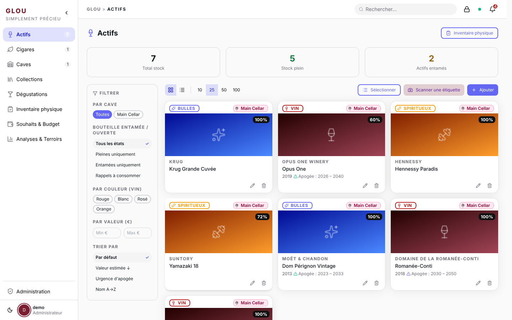
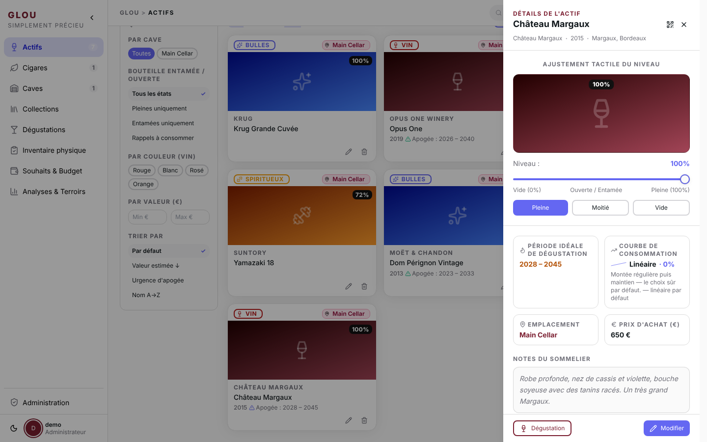
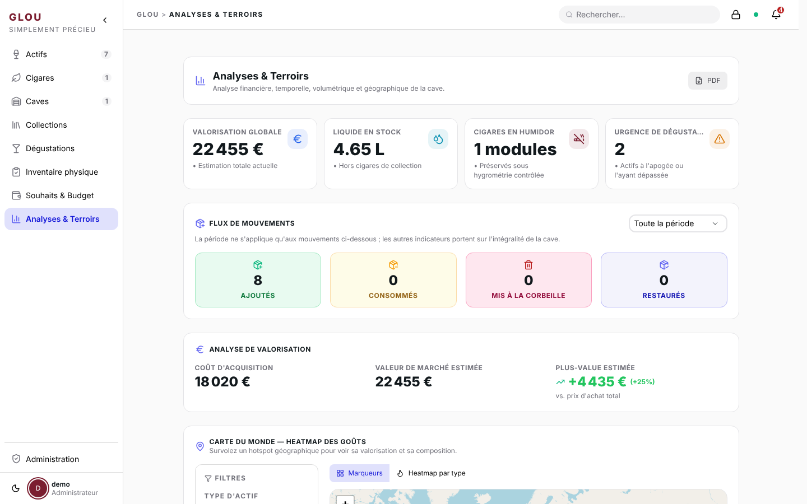

<div align="center">
  <h1>Glou</h1>
  <p><strong>Simplement précieux.</strong></p>
  <p>Glou est un gestionnaire d'actifs auto-hébergé pour collections de luxe : vins, spiritueux, bulles et cigares. Reconnaissance d'étiquettes, données d'experts et indicateurs d'apogée dans une stack que vous hébergez vous-même.</p>
</div>

---

## Le top 5
1. Saisie par étiquette : photographiez une étiquette et le scan pré-remplit les détails (le scan d'étiquette par IA est optionnel).
2. Inventaire partagé : tous les utilisateurs de l'instance partagent une même cave, pour les familles, colocataires et clubs. Les inscriptions sont fermées dès que l'admin existe ; vous décidez quand les ouvrir.
3. Alertes d'apogée : vous êtes notifié quand une bouteille entre dans sa fenêtre de dégustation.
4. Auto-hébergé : une stack Docker Compose (Node.js · Next.js · PostgreSQL) que vous faites tourner chez vous.
5. Partage invité : liens limités à un périmètre et révocables, pour laisser des proches consulter (ou aider à inventorier) une partie de votre cave.

---

## Captures d'écran

<table>
  <tr>
    <td width="50%"></td>
    <td width="50%"></td>
  </tr>
  <tr>
    <td align="center"><strong>Inventaire partagé</strong><br/><sub>Cartes, filtres à facettes et statistiques de stock en direct.</sub></td>
    <td align="center"><strong>Détail d'un actif &amp; traçabilité</strong><br/><sub>Niveau de remplissage, journal de dégustation et historique par champ avec restauration.</sub></td>
  </tr>
  <tr>
    <td colspan="2"></td>
  </tr>
  <tr>
    <td colspan="2" align="center"><strong>Analyses &amp; Terroir</strong><br/><sub>Valorisation, flux de mouvements, urgence de dégustation et vue géographique de votre cave.</sub></td>
  </tr>
</table>

---

## Démarrage rapide

**Prérequis :**
- Docker installé et en cours d'exécution, sur un hôte 64 bits Intel/AMD ou ARM (Raspberry Pi 4/5, NAS ARM…) : les images sont publiées pour `linux/amd64` et `linux/arm64`.

**Étape 1 : Configurer**
```bash
cp .env.example .env
```
Ouvrez `.env` et renseignez trois valeurs obligatoires, dont aucune n'a de valeur par défaut sûre :
- `DB_PASSWORD` : docker compose refuse de démarrer sans elle.
- `JWT_SECRET` : générez-en une avec : `openssl rand -base64 48`
- `CONFIG_ENCRYPTION_KEY` : générez-en une avec : `openssl rand -hex 32`

> [!CAUTION]
> Utiliser les valeurs d'exemple rend toutes les sessions utilisateurs falsifiables, et l'API refuse de démarrer en mode production tant que `CONFIG_ENCRYPTION_KEY` n'a pas une vraie valeur.

**Étape 2 : Lancer**
```bash
# Linux uniquement : l'API tourne sous l'uid 1001 et écrit les sauvegardes dans ./backups.
# Créez le dossier avant, sinon Docker le crée en root et chaque sauvegarde échoue.
mkdir -p backups && sudo chown 1001:1001 backups
docker compose up -d
```
Docker télécharge les images pré-construites et démarre la stack. Aucune compilation requise.

> [!NOTE]
> Le scan d'étiquette par IA est optionnel et désactivé par défaut (~9 Go de disque, ~3 Go de RAM). Activez-le avec `docker compose --profile scan up -d`.

**Étape 3 : Créer votre compte**

Rendez-vous sur [http://localhost:3000](http://localhost:3000) et cliquez sur **S'inscrire**. Le premier compte créé reçoit automatiquement les droits administrateur.

> [!NOTE]
> Une fois ce premier compte créé, **l'inscription est fermée**. Pour laisser d'autres personnes s'inscrire, un admin active **Autoriser l'inscription de nouveaux comptes** dans **Administration → Configuration Système → Réseau**, et peut la désactiver ensuite.

> [!TIP]
> Pour mettre à jour vers une nouvelle version : `docker compose pull && docker compose up -d`. Faites d'abord une sauvegarde (**Administration → Configuration Système → Sauvegardes → Sauvegarder maintenant**) ; pour revenir en arrière, voir [Mises à jour et retour arrière](./docs/wiki/FR/31-Mises-A-Jour-Et-Retour-Arriere.md).

*Pour la configuration avancée, les variables d'environnement et le dépannage, consultez le [Wiki](./docs/wiki/FR/_wiki.md).*

---

## Roadmap

### Récemment ajouté
- Mode Expert / Collectionneur : grille de dégustation de sommelier, champs appellation et fût, et panneau humidor sur chaque objet ; un interrupteur individuel et réversible.
- Scan d'étiquette : un modèle de vision auto-hébergé, sans GPU, pré-remplit nom, producteur, catégorie et millésime depuis une photo d'étiquette.
- Accords mets et bouteilles : tapez un plat, obtenez une sélection classée de votre propre cave avec un bouton « consommer maintenant ».
- Plan de consommation : une liste personnelle « à boire maintenant / prochainement » à partir des apogées et de la rotation, plus un objectif mensuel.
- Liste de souhaits et budget : prix plafonds, alertes bonnes affaires sur prix observés, et enveloppe budgétaire par période.
- Mode hors ligne : consultez et modifiez les items chargés hors connexion ; les changements se synchronisent automatiquement avec résolution de conflit.
- Carte du monde, heatmap et filtres : explorez la collection géographiquement et filtrez par prix, millésime, note ou état.
- Sauvegardes planifiées et portabilité : sauvegardes nocturnes de la base (activées par défaut, rattrapage des exécutions manquées, échecs signalés aux admins) restaurables en tout ou rien, plus un export RGPD complet, intégral ou filtré.
- Inscription fermée par défaut : seul le premier compte (l'admin) s'inscrit librement ; un admin ouvre l'inscription au besoin.
- Accès clavier et lecteur d'écran : grille de cave, filtres, tableaux et recherche utilisables au clavier, focus géré dans les panneaux, erreurs annoncées.
- Exploitation plus sûre : tags d'image immuables par SHA de commit pour le retour arrière, vérification au démarrage des secrets requis, et guides de [rotation des secrets](./docs/wiki/FR/29-Rotation-Des-Secrets.md), de [reprise après sinistre](./docs/wiki/FR/30-Reprise-Apres-Sinistre.md) et de [mise à jour](./docs/wiki/FR/31-Mises-A-Jour-Et-Retour-Arriere.md).

Des dizaines de fonctionnalités plus petites sortent régulièrement ; voir les [pull requests fermées](https://github.com/jackthomasanderson/glou-server/pulls?q=is%3Apr+is%3Aclosed) pour l'historique complet.

### À venir
- Smart Data Engine : enrichissement automatique via Vivino et Whiskybase, avec cache local. Pas encore construit : les clés d'intégration de l'écran admin ne sont lues par aucun code aujourd'hui.
- Analyses prédictives pour la valorisation de la collection.
- Intégration IoT avancée pour le suivi en direct de la température et de l'hygrométrie.
- Application mobile native.

## Crédits / Tiers

- Ce produit inclut des données GeoLite créées par MaxMind, disponibles sur [http://maxmind.com/](http://maxmind.com/).
- Contours de la carte du monde issus de [Natural Earth](https://www.naturalearthdata.com/) (domaine public), via [world-atlas](https://github.com/topojson/world-atlas).
